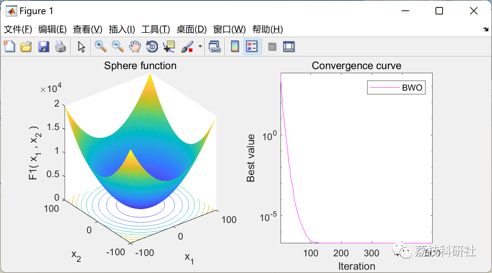
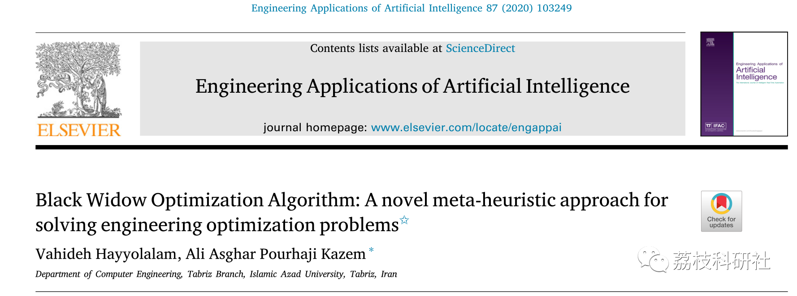

# Black Widow Optimization Algorithm (Matlab Code Implementation)

💥💥💥💞💞💞 Welcome to this blog❤️❤️❤️ 💥💥💥
🏆 Bloggers' Advantages: 🌞🌞🌞 The content of the blog strives for rigorous thinking and clear logic to facilitate readers.
⛳️ Mantra: A journey of a thousand miles is begun with a single step.
Litchi Research Society
Code Collection: Power Systems, Intelligent Algorithms and Applications, Neural Network Prediction, Path Planning, Optimized Scheduling, Workshop Scheduling, Image Processing, Signal Processing...
🎁 Special Section Links:
🌈🌈🌈🌟🌟🌟🌟 Electrical Code Intelligent Algorithms and Their Applications Path Planning Neural Network Prediction Optimized Scheduling Image Processing Workshop Scheduling Signal Processing Romantic Her
💥1 Overview
Naturally inspired optimization algorithms can solve different engineering and scientific problems due to their simplicity and flexibility. They can be applied metaheuristic algorithms without structural modifications to the optimization problem. Recently, metaheuristic algorithms have become a powerful method to solve NP-hard problems. In this paper, the author proposes a new metaheuristic algorithm suitable for continuous nonlinear optimization problems. The inspiration for the Black Widow Optimization Algorithm (BWO) comes from the unique mating behavior of the Black Widow Spider. This method includes an exclusive phase, namely the hunting phase. Due to this phase, species that are not fit for the circle are omitted early on, leading to early convergence. The BWO algorithm was evaluated on 51 different benchmark functions to verify its efficiency in obtaining the optimal solution. The results obtained indicate that compared to other algorithms, this algorithm has many advantages in terms of early convergence and achieving the best fitness value. Moreover, it is capable of providing competitive and promising results. The study also used the BWO algorithm to solve three different challenging engineering design problems. The results of the real case study problems demonstrate the effectiveness of the proposed algorithm in solving real-world problems with unknown and challenging spaces.
📚2 Running Results
🎉3 References
🌈4 Matlab Code Implementation and Detailed Article
Click the article's lower left corner to read more.

## Images

<!-- PAYMENT_BLOCK -->

## Get this dataset

- Payment link (Stripe): [Buy now](https://buy.stripe.com/3cs8yP7sY87d0vu9AB)
- Payment QR code: 

<!-- /PAYMENT_BLOCK -->
